<!-- Built from the Nexus design: Cyber Obsidian colours, Chakra Petch / JetBrains Mono -->


## Hi, I'm Naimul

I've been building software for over 7 years, mostly microfinance, core banking, supply chain and HRM systems. Most of my time goes into the frontend, but I also write the APIs, tune the SQL and set up the CI/CD, so I can take a feature from the first client call to production.

- **Now:** Full Stack Developer at Matco X Korea Software Partnership. LLM chatbots with RAG, and a recruitment platform with OCR document scanning.
- **Before:** Proshika (fixing and speeding up a microfinance system), LEADS Corporation (core banking, Scrum Master), Creatrix Soft Tech (supply chain and ERP).
- **Research:** three NLP and deep learning papers, in Elsevier, MDPI and ICDSNS.
- **Ask me about:** SQL that got slow, old apps that need a new frontend, running LLMs on plain CPUs.

## How a project goes

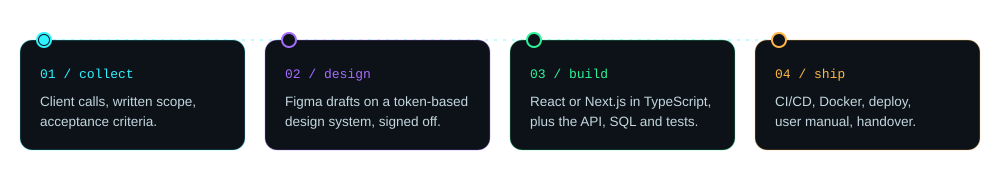

## What I work with


## Products I've built

<a href="https://github.com/pulok529/wikdom"></a>
<a href="https://github.com/pulok529/medget"></a>

<a href="https://github.com/pulok529/mango-hrm"></a>
<a href="https://github.com/pulok529/hisab"></a>

<a href="https://github.com/pulok529/credigen"></a>

## Featured work

<a href="https://github.com/pulok529/pulse-sender"></a>
<a href="https://github.com/pulok529/brieflow"></a>

<a href="https://github.com/pulok529/theme-studio"></a>
<a href="https://github.com/pulok529/industry-demos"></a>

<a href="https://github.com/pulok529/bornomala-modernization"></a>
<a href="https://github.com/pulok529/project_arcmorph"></a>

<a href="https://github.com/pulok529/nexus-portfolio"></a>
<a href="https://github.com/pulok529/database-mastery"></a>

<a href="https://github.com/pulok529/devops-playbook"></a>
<a href="https://github.com/pulok529/pulak-platform"></a>

## Concept builds

Each one does the kind of work a real client needs, built on my shared design system.

<a href="https://github.com/pulok529/claimtrack"></a>
<a href="https://github.com/pulok529/triageai"></a>

<a href="https://github.com/pulok529/sunplan"></a>
<a href="https://github.com/pulok529/pulseboard"></a>

<a href="https://github.com/pulok529/applyly"></a>
<a href="https://github.com/pulok529/slotbook"></a>

<a href="https://github.com/pulok529/pilotdesk"></a>
<a href="https://github.com/pulok529/gridmind"></a>

<a href="https://github.com/pulok529/senku"></a>

## Activity

<picture>
  <source media="(prefers-color-scheme: dark)" srcset="https://raw.githubusercontent.com/pulok529/pulok529/output/snake-dark.svg" />
  
</picture>

## Get in touch

Open to remote full stack and frontend roles with full US-hours overlap. Email is the fastest way to reach me.

