  

  

  <b>I build reliable banking and ERP systems and turn NLP research into products.</b> 
  🛠️ Currently building <a href="https://github.com/pulok529/project_arcmorph">ArcMorph</a>, a local-AI tool that analyses a codebase and plans its modernisation.

<!-- 3D portfolio preview: enable once pulak.dev is live

  

-->

  

## 🧩 Featured systems

<table>
  <tr>
    <td width="50%" valign="top">
      <h3><a href="https://github.com/pulok529/project_arcmorph">ArcMorph</a></h3>
      Local-AI code analysis &amp; modernisation: maps a codebase, reports problems and plans refactors to a new stack.  
      
    </td>
    <td width="50%" valign="top">
      <h3><a href="https://github.com/pulok529/Aptech_ERP">Aptech ERP</a></h3>
      Modular ERP for production, merchandising, commercial, inventory and accounting, with Crystal Reports MIS.  
      
    </td>
  </tr>
  <tr>
    <td width="50%" valign="top">
      <h3><a href="https://github.com/pulok529/Commercial_Management">Commercial Management</a></h3>
      ERP module for letters of credit, indents, shipments and customs, with approvals and hand-offs to inventory &amp; finance.  
      
    </td>
    <td width="50%" valign="top">
      <h3><a href="https://github.com/pulok529/orderprocessapi">OrderProcess API</a></h3>
      Sales &amp; distribution order service with Kubernetes manifests and Terraform for AWS (VPC, EKS, ECR, RDS).  
      
    </td>
  </tr>
  <tr>
    <td width="50%" valign="top">
      <h3><a href="https://github.com/pulok529/ProshikaDataMigSSIS">Proshika Data Migration</a></h3>
      SSIS data-integration project migrating legacy NGO data into SQL Server.  
      
      
      
    </td>
    <td width="50%" valign="top">
      <h3><a href="https://github.com/pulok529/transaction_fraud_anomaly">Transaction Fraud Anomaly</a></h3>
      Fraud &amp; anomaly detection on synthetic transactions: Isolation Forest baseline, threshold tuning and a scoring service.  
      
    </td>
  </tr>
</table>

  

## 🧰 Tech stack

**Backend** 

**Data** 

**Cloud &amp; DevOps** 

**AI / ML** 

## 📚 Publications

- **Multi-class sentiment classification on Bengali social media comments using machine learning** 
  *International Journal of Cognitive Computing in Engineering* (Elsevier), 2023 
  
- **A Comparative Analysis on Suicidal Ideation Detection Using NLP, Machine, and Deep Learning** 
  *Technologies* 10(3):57 (MDPI), 2022 
  
- **Deep Learning for Multi-Labeled Cyberbully Detection: Enhancing Online Safety** (first author) 
  *2023 International Conference on Data Science and Network Security (ICDSNS)*, IEEE 
  

## 📈 Activity

  <picture>
    <source media="(prefers-color-scheme: dark)" srcset="profile-3d-contrib/profile-night-rainbow.svg">
    <source media="(prefers-color-scheme: light)" srcset="profile-3d-contrib/profile-gitblue.svg">
    
  </picture>

  
  

  <picture>
    <source media="(prefers-color-scheme: dark)" srcset="https://raw.githubusercontent.com/pulok529/pulok529/output/github-snake-dark.svg">
    <source media="(prefers-color-scheme: light)" srcset="https://raw.githubusercontent.com/pulok529/pulok529/output/github-snake.svg">
    
  </picture>

## 🤝 Connect

  
  
  <!--  -->

