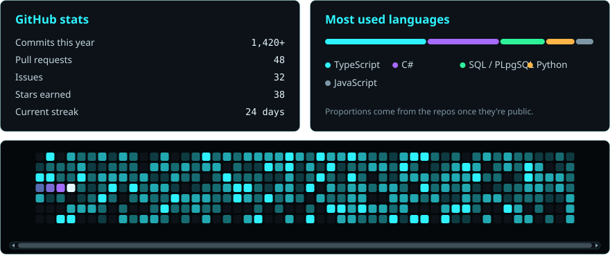

<!-- Built from the Nexus design: Cyber Obsidian colours, Chakra Petch / JetBrains Mono -->

  

  

## Hi, I'm Naimul

I've been building software for over 7 years, mostly microfinance, core banking, supply chain and HRM systems. Most of my time goes into the frontend, but I also write the APIs, tune the SQL and set up the CI/CD, so I can take a feature from the first client call to production.

- **Now:** Full Stack Developer at Matco X Korea Software Partnership. LLM chatbots with RAG, and a recruitment platform with OCR document scanning.
- **Before:** Proshika (fixing and speeding up a microfinance system), LEADS Corporation (core banking, Scrum Master), Creatrix Soft Tech (supply chain and ERP).
- **Research:** three NLP and deep learning papers, in Elsevier, MDPI and ICDSNS.
- **Ask me about:** SQL that got slow, old apps that need a new frontend, running LLMs on plain CPUs.

## How a project goes

  

## What I work with

  

## Products I've built

  
  

  
  

  
  

## Featured Repositories & Engineering Systems

  
  

  
  

  
  

<b>View More System Architectures & Concept Engines (8)</b>

 

  
  

  
  

  
  

  
  

## Activity

  

## Get in touch

Open to remote full stack and frontend roles with full US-hours overlap. Email is the fastest way to reach me.

  
  &nbsp;
  

  

